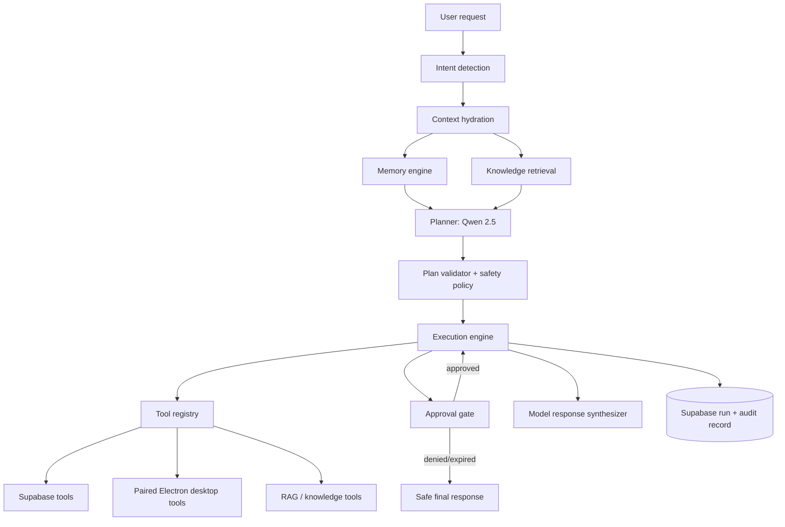
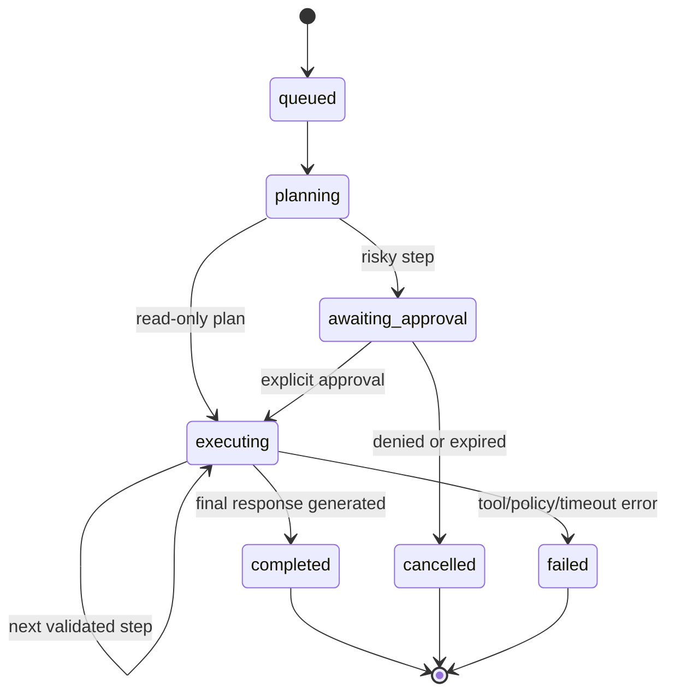

# Phase 10 — JVerse AI Agent

## Agent architecture

The agent runs only in the Python brain/control plane. It never receives service-role credentials in a prompt, never exposes raw tool schemas to the browser, and never gives Qwen 2.5 unbounded tool access. Every tool call is policy-validated and durable execution state is recorded in Supabase through the existing Phase 2 agent/run/audit data model. The existing Node service is transitional and must not become a second agent authority.

## Planning system

1. **Intent detection** classifies the request, desired outcome, domain, risk, and whether tools are necessary.
2. **Context hydration** reads only the caller's workspace-scoped Phase 7 memory and Phase 8 retrieval evidence.
3. **Planning** asks the model for structured JSON against a restricted tool catalogue.
4. **Validation** rejects unknown tools, raw paths, cross-workspace IDs, unsupported models, too many steps, cyclic plans, and policy-incompatible actions.
5. **Approval insertion** adds a hard wait step before any external or desktop-changing action.

Plans have bounded maximum steps/time/cost. They are declarative data, not executable shell code.

## Execution system

The execution engine persists run state before each action. A retry is idempotency-keyed and tools must declare whether they are safe to retry. Tool output is normalized/redacted before it becomes model context or an audit record.

## Tool boundaries

| Tool family | Authority | Approval rule |
| --- | --- | --- |
| Supabase workspace reads | Control plane, scoped caller identity | No approval for authorized read-only use |
| Memory retrieval | Phase 7 service, scoped workspace + user | No approval |
| Knowledge retrieval | Phase 8 service, scoped workspace | No approval |
| Create/update/archive product records | Control plane | Explicit approval before mutation |
| Desktop open file/folder/application | Paired Electron main process, capability token only | Always explicit approval |
| Notifications | Paired Electron main process | Explicit approval unless user enabled a specific automation rule |
| Local Qwen/Ollama generation | Paired Electron main process | No approval for generation; policy and model allowlist required |

Desktop tools never accept arbitrary paths or command strings. A desktop capability token represents a user-selected resource or an allowlisted picker operation and expires quickly.

## Safety controls

- Server-side Supabase identity and workspace membership verification before every run and tool call.
- Explicit user approval with action summary, target, reversibility, and expiry for mutations/external effects.
- Per-tool allowlist, JSON-schema validation, timeouts, concurrency limits, and idempotency keys.
- Deny-by-default desktop gateway, localhost-only Ollama, and no renderer-to-Ollama path.
- Prompt injection isolation: memory/RAG text is evidence, never tool instruction authority.
- Policy/order priority: platform safety → workspace policy → explicit user approval → validated plan → tool result.
- Durable audit records store tool identity, action class, status, timing, and redacted result metadata—not raw secrets or unrestricted user content.
- Kill switch, run cancellation, and step budgets stop multi-step loops.

## Integration sequence

1. Phase 6 chat sends an authenticated agent request to the control plane.
2. Agent hydrates Phase 7 memory and Phase 8 knowledge evidence.
3. Qwen 2.5 returns a constrained structured plan.
4. Validator and safety policy gate each step.
5. Read tools call Supabase services; desktop tools call only the paired Electron main process.
6. The engine streams status and answer events to chat, then writes durable run/audit data to Supabase.
