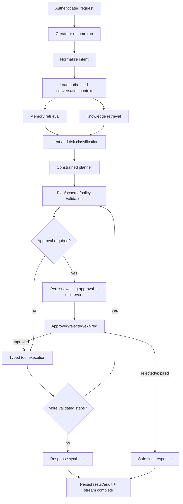

# Phase 13 — JVerse Python Agent Brain

**Status:** Source-of-truth design; no implementation code.  
**Stack:** Python 3.12+, FastAPI, LangGraph, Pydantic.  
**Governing sources:** Phases 1–12 and ADR-0009.

## 1. Agent architecture

The Python Agent is JVerse's trusted reasoning and orchestration brain. It receives authenticated user intent through the Next.js BFF, builds scoped context, plans bounded work, requests permitted tools, streams lifecycle events, and records durable state in Supabase.

```text
Next.js BFF → FastAPI gateway → identity/workspace guard
  → LangGraph run → context assembly
  → intent + risk → plan → policy/approval gate
  → read/tool execution → synthesis → SSE events
  → Supabase conversation/run/audit persistence

Electron main ↔ paired desktop gateway ↔ local Ollama/Qwen, Whisper/Piper, OS tools
```

The model proposes structured intent, plans, and tool arguments. It never receives service-role secrets, raw device tokens, generic shell access, or direct database/OS authority.

## 2. FastAPI structure

```text
services/brain/
├─ app/
│  ├─ main/                 # app factory, lifespan, route assembly
│  ├─ api/v1/               # authenticated HTTP/SSE endpoints
│  ├─ core/                 # settings, logging, correlation, security
│  ├─ contracts/            # Pydantic request, response, event models
│  ├─ dependencies/         # principal, workspace, request-context guards
│  ├─ application/          # use-case orchestration
│  ├─ domain/               # agent, conversation, memory, policy invariants
│  ├─ graph/                # LangGraph state, nodes, edges, checkpoints
│  ├─ services/             # context, retrieval, planning, execution, synthesis
│  ├─ tools/                # typed tool definitions and executors
│  ├─ infrastructure/       # Supabase, paired Electron, model, queue adapters
│  └─ observability/        # audit, metrics, safe tracing
├─ tests/                   # unit, contract, policy, integration, adversarial tests
├─ pyproject.toml
└─ README.md
```

`api` handles transport only. `application` coordinates use cases. `domain` owns invariants. `infrastructure` translates ports to vendors. No route directly calls Supabase, Ollama, Electron, or LangGraph internals.

## 3. LangGraph workflow



Graph state includes `run_id`, verified `principal`, `workspace_id`, bounded message history, memory evidence, knowledge citations, intent/risk, declarative plan, approval state, tool results, token/time budgets, and correlation ID. It excludes credentials, raw audio, arbitrary file paths, and unrestricted model instructions.

Checkpoints persist only recoverable, redacted execution state. A resumed graph revalidates identity, workspace membership, approvals, capability grants, and tool idempotency before any execution.

## 4. Tool architecture

| Tool family | Executor | Default policy |
|---|---|---|
| Conversation/memory/knowledge reads | Python Supabase repository | Authorized read; citation/provenance required |
| Product mutation | Python application service | Explicit approval before mutation |
| Knowledge retrieval | Retrieval service | Workspace scope, context budget, no instruction authority |
| Local Qwen generation | Paired Electron main | Model allowlist; no browser-to-Ollama path |
| Whisper/Piper voice | Paired Electron main | Local-only, consented microphone/speech lifecycle |
| Desktop apps/files/folders | Paired Electron main | Capability token and explicit approval |
| Notifications | Paired Electron main | Approval unless an approved automation rule exists |

Every tool has a Pydantic input/output contract, risk tier, timeout, cancellation behavior, idempotency classification, capability requirement, audit schema, and user-facing failure translation. The registry rejects unknown tools, raw commands, raw paths, cross-workspace IDs, and undeclared side effects.

## 5. Service layers

| Layer | Services | Responsibility |
|---|---|---|
| API | request parsing, SSE, health, OpenAPI | transport and authenticated entry only |
| Application | start run, continue approval, cancel run | coordinate transactions and graph lifecycle |
| Domain | policy, plan validation, run lifecycle, memory rules | framework-independent invariants |
| AI orchestration | context assembly, classifier, planner, synthesizer | bounded model interaction |
| Tool services | executor, approval, capability, idempotency | safe typed side effects |
| Infrastructure | Supabase, Electron pairing, model gateway, queue | vendor translation only |
| Operations | audit, metrics, traces, health | redacted observability and recovery |

## 6. API contracts

All contracts are Pydantic models versioned under `/v1`. The Next BFF validates the Supabase session; FastAPI verifies the forwarded JWT/principal again. `user_id` is derived from verified identity, never trusted from body input.

| Endpoint | Request | Response/event contract |
|---|---|---|
| `POST /v1/agent/runs` | workspace, conversation, user intent, optional model preference | run metadata then SSE lifecycle events |
| `GET /v1/agent/runs/{id}` | route ID | caller-scoped redacted run projection |
| `POST /v1/agent/runs/{id}/approval` | approval decision, single-use approval token | resumed/cancelled run event stream |
| `POST /v1/agent/runs/{id}/cancel` | route ID | idempotent cancellation projection |
| `POST /v1/chat/stream` | workspace, conversation, message, model | `metadata`, `delta`, `tool`, `approval`, `error`, `done` SSE events |
| `POST /v1/devices/pair` | signed desktop pairing request | device-bound pairing challenge/result |
| `GET /health` | none | dependency-safe health projection, no secrets |

Every SSE event has `version`, `run_id`, `sequence`, `correlation_id`, `type`, and typed payload. Clients ignore unknown event types to allow additive evolution. Error payloads use stable public codes: `unauthenticated`, `forbidden`, `validation`, `unavailable`, `approval_required`, `cancelled`, and `unexpected`.

## 7. Electron communication

Electron main initiates an outbound, device-authenticated pairing connection to the Python brain; the brain never opens an inbound connection to a user's machine. Pairing is linked to the Supabase device registration, revocable capability grants, short-lived challenge/token material, and audit events.

Python sends only typed requests: generation, voice state/control, approved desktop action, health, and cancellation. Electron returns typed progress, result, error, and availability events. Raw microphone streams, filesystem handles, OS tokens, and generic IPC are never transmitted.

## 8. Acceptance gates

- FastAPI verifies identity/workspace scope at every route and graph resume.
- LangGraph execution has explicit bounded state, step/time/token budgets, cancellation, and approval pauses.
- Memory/RAG evidence is scoped, bounded, labelled as untrusted context, and cited.
- No tool bypasses Pydantic validation, policy, capability, approval, idempotency, timeout, or audit requirements.
- Paired Electron is the sole local Qwen/Whisper/Piper/OS authority.
- The Node control plane remains a feature-flagged compatibility adapter only until parity, migration, negative security, and rollback tests pass.
