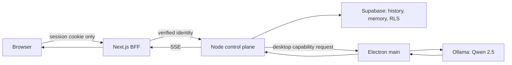

# Phase 6 — AI Chat System

## Status and architectural boundary

This phase implements the web chat surface and the protected streaming boundary. It does not allow a browser or a Next.js route to call Ollama directly. That would violate the Phase 1 authority model: Ollama/Qwen 2.5 is a local provider owned by the Electron main process, while the Node.js control plane owns agent policy, memory assembly, persistence, and provider selection.

The Supabase database remains the durable source of truth for conversation history and memory. A local desktop cache is disposable and must reconcile with the cloud record.

## Folder structure

```text
app/
  (protected)/chat/page.tsx                 # authenticated chat workspace
  api/chat/stream/route.ts                  # narrow, authenticated BFF stream proxy
components/chat/
  chat-workspace.tsx                        # conversation UI and streaming state
  markdown-message.tsx                      # GFM rendering and code highlighting
lib/ai/
  contracts.ts                              # stable request/event type contracts
services/control-plane/                     # Phase 1 Node/Express ownership boundary
  src/modules/chat/
    chat.routes.ts
    chat.controller.ts
    chat-orchestrator.service.ts
    conversation.repository.ts
    memory.service.ts
    provider-router.service.ts
    stream.service.ts
  src/modules/providers/ollama/
    ollama-provider.adapter.ts
electron/
  main/ai/
    ollama-ipc.service.ts                   # sole desktop-local Ollama authority
  preload/ai-api.ts                         # typed, narrow renderer bridge
supabase/
  migrations/                               # Phase 2 conversation/message/memory schema
```

## API design

### Web BFF

| Route | Method | Responsibility |
| --- | --- | --- |
| `/api/chat/stream` | `POST` | Validates the Supabase session, validates the request shape, and proxies an event stream to the control plane. |
| `/api/chat/conversations` | `GET` | Lists the caller's conversations through the control plane. |
| `/api/chat/conversations/:id/messages` | `GET` | Cursor-paginates durable history. |
| `/api/chat/conversations/:id/archive` | `POST` | Archives a conversation; it never hard-deletes user data from the browser. |

`POST /api/chat/stream` body:

```json
{
  "conversationId": "uuid | null",
  "workspaceId": "uuid",
  "message": "User prompt",
  "model": "qwen2.5:7b"
}
```

Events are Server-Sent Events (SSE), encoded as JSON payloads:

```text
event: delta    data: {"type":"delta","text":"partial response"}
event: metadata data: {"type":"metadata","conversationId":"uuid","messageId":"uuid"}
event: done     data: {"type":"done","usage":{"inputTokens":0,"outputTokens":0}}
event: error    data: {"type":"error","code":"...","message":"..."}
```

### Control plane

The Node/Express service receives only an authenticated, server-to-server request from the BFF. It verifies tenant membership, loads the latest conversation window, retrieves scoped memory/knowledge, applies agent and tool policy, and selects an allowed provider. It persists the user message before generation and persists the completed assistant message after the stream completes.

No client receives a Supabase service-role key, an Ollama endpoint, an Electron IPC handle, or an unrestricted model/tool selector.

## Service design

| Service | Owner | Responsibility |
| --- | --- | --- |
| `ChatOrchestratorService` | Node control plane | Validates membership, coordinates durable history, memory, agent policy, provider and stream lifecycle. |
| `ConversationRepository` | Node control plane / Supabase | Reads and writes conversation and message records under workspace and user boundaries. |
| `MemoryService` | Node control plane / Supabase pgvector | Creates scoped recall candidates; it does not expose cross-workspace memory. |
| `ProviderRouterService` | Node control plane | Selects `ollama-qwen2.5` only when desktop-local capability and policy permit it. |
| `OllamaProviderAdapter` | Electron main process | Calls Ollama's local API, maps Qwen 2.5 chunks to provider-neutral stream events, and enforces model allowlists/timeouts. |
| `ChatStreamService` | Node control plane | Converts provider chunks into SSE, handles cancellation and final persistence. |
| `ChatWorkspace` | Next client | Renders history, sends an authenticated request to the BFF, incrementally renders stream events, and never owns durable state. |

## Data flow

```mermaid
sequenceDiagram
  participant U as User
  participant W as Next.js chat workspace
  participant B as Next.js BFF
  participant C as Node control plane
  participant S as Supabase
  participant E as Electron main process
  participant O as Ollama / Qwen 2.5

  U->>W: Send prompt
  W->>B: POST /api/chat/stream (session cookie)
  B->>B: Verify Supabase user
  B->>C: Authenticated stream request
  C->>S: Verify workspace membership; load history + scoped memory
  C->>S: Persist user message
  C->>E: Request local-provider stream
  E->>O: Generate with Qwen 2.5
  O-->>E: Token chunks
  E-->>C: Provider-neutral events
  C-->>B: SSE delta events
  B-->>W: SSE delta events
  W-->>U: Incremental Markdown render
  C->>S: Persist completed assistant message and usage
```



## Security and resilience requirements

- RLS remains the data authority; the browser performs no privileged database writes.
- The BFF must use `auth.getUser()` server-side, never just decode unverified JWT claims.
- The Electron preload exposes a minimal typed allowlist, never raw Node/Ollama access.
- Stream aborts cancel the provider request and mark incomplete responses correctly.
- Provider timeout, unavailable desktop agent, invalid model, and policy denial return typed error events.
- Markdown is rendered without raw HTML; links are sanitized and code is highlighted client-side only.
- Conversation history is cursor-paginated; model context is a bounded, policy-controlled window rather than the complete transcript.

## Development sequence

1. Ship the protected web BFF and chat surface with the typed stream contract.
2. Implement the Node/Express control-plane chat module against the existing Phase 2 schema.
3. Implement Electron main/preload IPC and the Ollama Qwen 2.5 adapter.
4. Add durable conversation/message persistence and scoped memory retrieval.
5. Add cancellation, reconnect, observability, load tests, and policy tests.
6. Enable the desktop provider only after its security boundary and model lifecycle tests pass.
