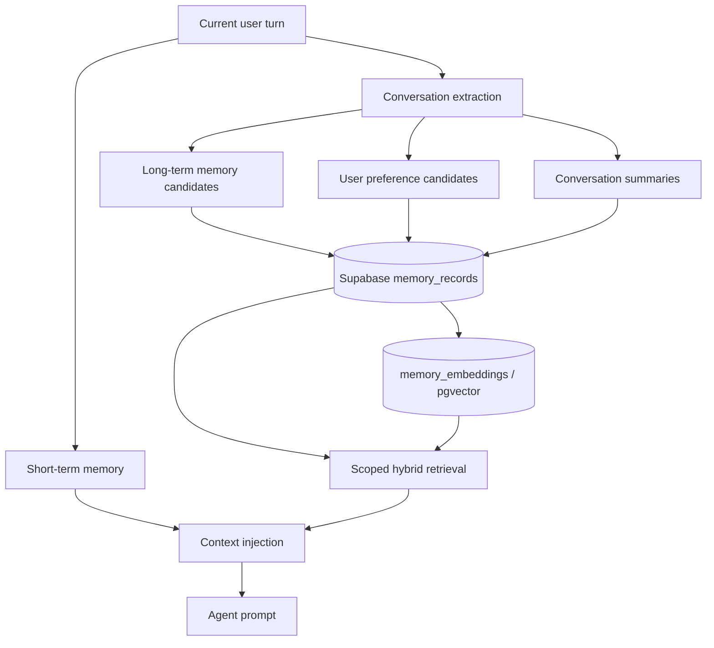
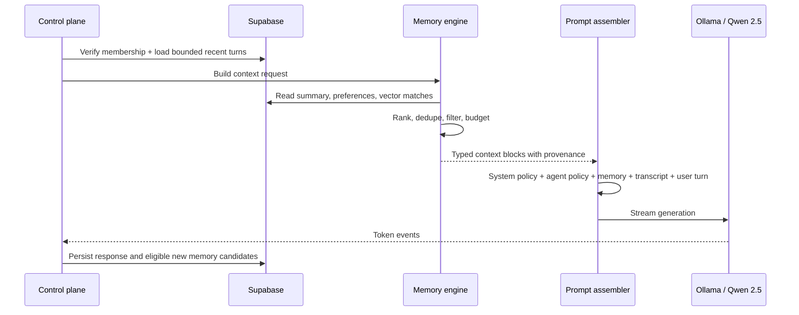

# Phase 7 — Memory Engine

## Objective

JVerse AI retains useful, user-scoped information without treating an entire historical transcript as prompt context. Supabase is the durable record. The Node control plane is the only component that extracts, retrieves, ranks, writes, supersedes, or injects memory. The browser renders the result but does not make memory decisions.

## Memory architecture



| Layer | Retention | Store | Purpose |
| --- | --- | --- | --- |
| Short-term memory | Current request only | Control-plane request scope, derived from the latest bounded transcript | Preserves immediate turn-taking and in-progress tool state. It is never an unbounded client cache. |
| Conversation memory | Durable and compact | `memory_records` with `memory_kind = conversation_summary` | Summary checkpoints for a conversation; replaces repeated old turns in context. |
| Long-term memory | Durable until superseded, expired, or deleted | `memory_records` + `memory_embeddings` | Explicit facts, commitments, stable goals, and confirmed user details. |
| User preferences | Durable and user-scoped | `memory_records` with `memory_kind = user_preference` | Interaction style, preferred format, explicit defaults, and opt-in personalization. |

## Supabase database integration

Migration `0010_memory_engine.sql` adds:

- `memory_records`: workspace- and user-scoped canonical memory records.
- `memory_embeddings`: one provider/model-labelled pgvector embedding per record.
- `match_memory_records(...)`: RLS-aware vector retrieval function.
- Partial indexes for active scoped retrieval, conversation summaries, and expiry work.
- Read RLS for members; no browser write policy. The server-side control plane owns writes with a protected credential.

The migration uses `conversation_id` and `source_message_id` as opaque IDs so it integrates with the existing Phase 2 conversation/message relationships without inventing a competing chat schema.

## Retrieval strategy

1. Validate the user and workspace membership before any data read.
2. Load the current conversation’s newest bounded turns for short-term memory.
3. Load the newest valid conversation-summary memory for the active conversation.
4. Read eligible active user preferences, honoring their confidence, expiry, and consent metadata.
5. Embed the current request with the configured embedding provider.
6. Call `match_memory_records` constrained by *both* `workspace_id` and `user_id`.
7. Apply a final score using semantic similarity, importance, confidence, recency, and access frequency.
8. Deduplicate semantically equivalent records and reject expired, low-confidence, or policy-ineligible memory.
9. Fit results into a strict memory token/character budget; never allow retrieval to displace system policy or the current user request.
10. Record access metadata asynchronously after the model response completes.

No cross-workspace, cross-user, or raw-vector retrieval is permitted. Qwen 2.5 is the chat generation model. An embedding model is explicitly configured and recorded in each vector row; replacing it is a migration/re-embedding operation, not an implicit runtime change.

## Context injection system



Injection order is fixed:

1. Platform/system and safety policy.
2. Agent/workspace policy.
3. Explicit user preferences.
4. Current conversation summary.
5. Ranked long-term facts.
6. Recent short-term turns.
7. Current user message.

Each block carries provenance (`memory_id`, type, score, and source IDs) for observability. Retrieved text is context, not instruction authority: it must not override system policy or request tools directly.

## Write and lifecycle policy

- Extract only candidates that are useful beyond the current turn.
- Preference writes require explicit user intent or a confirmed setting; do not infer sensitive preferences.
- Facts receive confidence and expiry; contradicting facts are superseded instead of silently duplicated.
- Conversation summaries are regenerated at defined intervals and linked to their source conversation.
- Deletion/opt-out marks records unavailable immediately and cascades to vectors.
- A scheduled server job deletes expired records and re-embeds records when the configured embedding model changes.

## Control-plane module boundary

```text
services/control-plane/src/modules/memory/
  memory.types.ts
  memory.repository.ts
  supabase-memory.repository.ts
  memory-engine.service.ts
  context-injection.service.ts
  memory-extraction.service.ts
  memory-maintenance.job.ts
```

The next implementation unit wires this module into the Phase 6 `ChatOrchestratorService`, Electron local-provider capability checks, and an approved embedding provider. It must not move memory ownership into Next.js, Zustand, the browser, or Electron renderer code.
