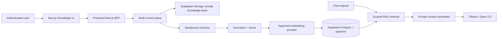
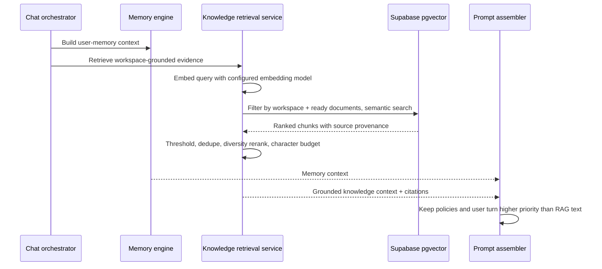

# Phase 8 — Knowledge Base and RAG

## Architectural boundary

The Knowledge Base is a private, workspace-scoped Retrieval-Augmented Generation (RAG) service. Supabase Storage stores original files in the private `knowledge-base` bucket. Supabase Postgres/pgvector stores document metadata, chunks, and embeddings. The Node control plane creates signed upload URLs, performs ingestion, and executes retrieval. The Next.js client never parses files, holds a service-role credential, creates embeddings, or executes raw vector search.

Supported source formats are PDF, DOCX, TXT, and Markdown only.

## RAG architecture



## Upload pipeline

```mermaid
sequenceDiagram
  participant U as User
  participant W as Next.js UI
  participant C as Node control plane
  participant S as Supabase Storage
  participant D as Supabase Postgres
  participant X as Ingestion worker

  U->>W: Select PDF, DOCX, TXT, or MD
  W->>C: Request validated signed upload
  C->>D: Verify membership; create queued document record
  C-->>W: Short-lived signed upload URL + scoped path
  W->>S: Upload directly to private bucket
  W->>C: Confirm upload
  C->>X: Queue document ingestion
  X->>S: Download source privately
  X->>X: Validate MIME/signature, extract, normalize, chunk
  X->>D: Write chunks + embeddings; mark document ready
```

### Ingestion controls

- Verify actual file signatures, not only filename extension or browser MIME type.
- Reject unsupported, encrypted, malformed, oversized, or archive-bomb documents before extraction.
- Parse PDF/DOCX in a sandboxed worker with network disabled and strict CPU/memory/time limits.
- Strip document macros, external links as executable behavior, and raw HTML/script content.
- Normalize Unicode, remove boilerplate where reliable, preserve page/heading provenance, and hash content for deduplication.
- Chunk on semantic boundaries where possible; retain a bounded overlap and source metadata (`page`, heading path, ordinal).
- A re-upload with the same workspace checksum is deduplicated or explicitly versioned by policy; it is never silently mixed with another workspace's content.

## Retrieval pipeline



The chat model receives selected excerpts plus immutable provenance, not unrestricted documents. The final response can cite a document/chunk; retrieved text is treated as reference data and cannot override platform or agent policy.

## Vector search strategy

1. Filter first by `workspace_id` and documents with `ingestion_status = ready`.
2. Embed the current query using the same approved embedding-model family used for the target chunks.
3. Run cosine similarity using `match_knowledge_chunks`.
4. Remove duplicate/adjacent chunks from the same source; reserve slots for diverse documents when relevant.
5. Combine semantic score with document freshness, source quality, and query/document metadata filters.
6. Enforce a minimum similarity and a strict context character/token budget.
7. Return citations including `document_id`, filename, chunk ordinal, and source metadata.

The migration deliberately uses dimension-agnostic `vector` storage. Before large-scale deployment, an ADR must choose an embedding model and its dimensionality, then add a model-specific HNSW/IVFFlat index and run a controlled re-embedding job. Qwen 2.5 is the approved generation model; it is not silently used as an embedding model.

## Supabase integration

`0011_knowledge_base_rag.sql` adds:

- `knowledge_documents`: private storage metadata, checksum, status, errors, and ingestion metadata.
- `knowledge_chunks`: workspace-scoped normalized chunks and provider/model-labelled pgvector embeddings.
- `match_knowledge_chunks`: service-role-only, scoped cosine similarity retrieval.
- RLS read boundaries tied to profile/workspace membership. Browser writes remain denied.
- Storage-bucket idempotency for the Phase 2 `knowledge-base` private bucket.

Storage path convention:

```text
knowledge-base/{workspace_id}/{document_id}/source/{sanitized-file-name}
```

The control plane must create paths—not the browser—and must check that the authenticated uploader belongs to the target workspace before granting a signed upload URL.

## Control-plane module structure

```text
services/control-plane/src/modules/knowledge/
  knowledge.types.ts
  knowledge.repository.ts
  supabase-knowledge.repository.ts
  upload-policy.service.ts
  ingestion-orchestrator.service.ts
  extraction/
    document-extractor.ts
    pdf-extractor.ts
    docx-extractor.ts
    text-extractor.ts
    markdown-extractor.ts
  chunking.service.ts
  embedding.service.ts
  retrieval.service.ts
  citation.service.ts
```

## Operational lifecycle

- Uploads start `queued`; only `ready` documents can participate in retrieval.
- Failures retain a non-sensitive failure code/message for recovery and observability.
- Delete requests remove source objects and cascade chunks/embeddings through the document record.
- A provider/model change triggers a versioned re-embedding workflow; old and new vector spaces are never queried together.
- Retrieval, ingestion, and citation events are audit logged without storing raw sensitive prompt text in logs.
