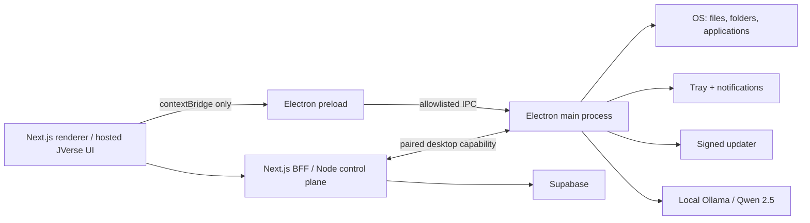

# Phase 9 — Electron Desktop Integration

## Architecture

The renderer has no Node.js APIs, filesystem access, process spawning, raw IPC access, Ollama URL, service-role credential, or updater capability. The Electron main process is the desktop authority. The Node control plane remains the authority for identity, workspace membership, memory, RAG, agent policy, and durable writes.

## Main process responsibilities

- Create a single hardened `BrowserWindow` and load only an approved JVerse origin.
- Own the system tray, native notifications, safe OS-open commands, lifecycle, and update lifecycle.
- Register narrow IPC handlers with sender-origin validation and payload validation.
- Own the local Ollama/Qwen 2.5 client; do not expose it directly to renderer code.
- Receive only capability-scoped, authenticated generation requests from the control-plane pairing channel.
- Enforce model allowlists, localhost-only Ollama access, request timeouts, cancellation, and event redaction.

## IPC structure

| Channel | Renderer access | Main-process behavior |
| --- | --- | --- |
| `desktop:open-file` | invoke | Native file picker followed by `shell.openPath`; no caller-supplied filesystem path. |
| `desktop:open-folder` | invoke | Native folder picker followed by `shell.openPath`. |
| `desktop:open-application` | invoke | Native executable/app picker followed by `shell.openPath`; arbitrary shell commands are never accepted. |
| `desktop:notify` | invoke | Displays a bounded native notification. |
| `desktop:updates:check` | invoke | Checks signed release metadata only in packaged builds. |
| `desktop:updates:download` | invoke | Downloads an already-verified update. |
| `desktop:updates:install` | invoke | Installs a downloaded update after renderer approval. |
| `desktop:updates:event` | event | Main-to-renderer, typed update state only. |
| `ai:*` | **not exposed** | Reserved for the main-process/control-plane local-provider bridge. |

## Security layer

- `contextIsolation: true`, `sandbox: true`, `nodeIntegration: false`, `webSecurity: true`.
- Navigation, `window.open`, permission requests, and new webviews are denied unless the target is an approved HTTPS JVerse origin.
- Preload uses `contextBridge`; it never exports `ipcRenderer`, `require`, `process`, or arbitrary callbacks.
- IPC is validated for sender origin, capability channel, payload shape/length, and user gesture through native pickers.
- No `exec`, shell string interpolation, unrestricted `openExternal`, or direct user-controlled paths.
- Auto-updates require signed Windows/macOS artifacts and HTTPS update metadata. Development builds never auto-update.
- Electron main performs localhost-only Ollama calls. The control plane sends policy-approved work; desktop renderer cannot call local models directly.

## Integration with Phases 3–8

- **Authentication:** Electron loads the approved HTTPS JVerse origin, so Supabase browser sessions and protected routes remain unchanged. A desktop pairing token is short-lived and separate from the browser JWT.
- **Chat:** Next.js BFF and Node control plane retain stream/memory authority. Electron main is the optional local provider capability for Qwen 2.5.
- **Memory:** The desktop cache is non-authoritative. Phase 7 Supabase memory remains durable and scoped.
- **Knowledge Base:** Upload, RAG, and citations remain in the control plane/Supabase. Electron may safely open a user-selected local file, but it cannot ingest arbitrary paths without an authenticated upload workflow.
- **Supabase:** No service-role key or direct privileged Supabase client exists in Electron renderer/preload.

## Packaging and updates

`electron-builder.yml` produces signed installers. CI injects code-signing material and the immutable HTTPS release feed URL; neither belongs in the repository. Electron updater events are surfaced through the typed preload API and require an explicit user install action.

## Verification checklist

1. Renderer cannot access `require`, `process`, `fs`, or `ipcRenderer`.
2. A non-JVerse page cannot invoke any exposed IPC handler.
3. File/folder/application requests always show the native picker.
4. Malformed notification/update payloads are rejected.
5. Development build skips update checks.
6. Packaged signed build checks only the configured HTTPS feed.
7. No renderer network request can reach `127.0.0.1:11434`.
8. Desktop-provided model work is paired, policy-scoped, cancellable, and logged without raw sensitive content.
